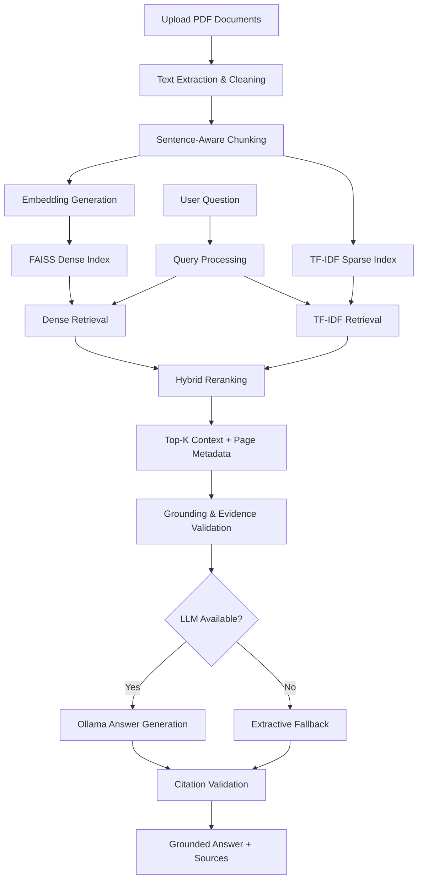

  EduDocAI
Intelligent Document Assistant · Retrieval-Augmented Generation
  Upload documents. Ask questions. Get answers grounded in your files.
  

    
    
    
    
    
  

  Built by Kartikey Gupta
Track C — NLP / Generative AI | EduRankAI AI Engineering & Data Science Internship Assessment

Overview
EduDocAI is an end-to-end document question-answering application built with Retrieval-Augmented Generation (RAG). It allows users to upload PDF documents, ask questions in natural language, and receive answers supported by document context and page-level citations.

The project also includes a benchmark workflow to compare TF-IDF retrieval with dense embedding-based retrieval, evaluate answer quality, and inspect performance metrics.
What you can do
- Upload one or more PDF documents and query their contents.
- Ask natural-language questions through a conversational interface.
- View answers with document and page citations.
- Compare sparse TF-IDF retrieval with dense vector retrieval.
- Run a benchmark using the included sample documents and annotated questions.
- Use a local Ollama model for generation—or an extractive fallback without a paid API.
Privacy-first execution: The core application can run locally without a paid API. The embedding model is downloaded on first use; Ollama is optional.

Features
Feature	Description
PDF ingestion	Extract text and page metadata using PyMuPDF
Document chunking	Configurable sliding-window chunks with overlap
Dense retrieval	Sentence Transformers embeddings with FAISS similarity search
Sparse retrieval	TF-IDF with bigrams and cosine similarity
Hybrid reranking	Combine dense and sparse retrieval signals
Grounded answers	Generate answers from retrieved document context
Source citations	Display document names and page references
Abstention	Avoid answering when relevant evidence is insufficient
Local LLM support	Optional Ollama integration
Evaluation dashboard	Retrieval, answer, citation, and abstention metrics
Automated tests	Pytest suite for core components

Architecture

Tech Stack
Layer	Tools
Interface	Streamlit
PDF processing	PyMuPDF
Text processing	Python
Embeddings	Sentence Transformers — all-MiniLM-L6-v2
Dense vector search	FAISS (IndexFlatIP)
Sparse retrieval	scikit-learn TF-IDF
Optional generation	Ollama (local LLM)
Data & analysis	NumPy, pandas
Visualization	Matplotlib
Validation & configuration	Pydantic, PyYAML, python-dotenv
Testing	pytest

Project Structure
EduDocAI/
├── app.py
├── requirements.txt
├── README.md
├── .env.example
├── .gitignore
├── assets/
│   └── logo.png
├── config/
│   └── settings.py
├── src/
│   ├── ingestion/
│   │   ├── document_loader.py
│   │   └── text_cleaner.py
│   ├── preprocessing/
│   │   └── chunking.py
│   ├── embeddings/
│   │   └── embedding_model.py
│   ├── retrieval/
│   │   ├── dense_retriever.py
│   │   ├── tfidf_retriever.py
│   │   ├── document_filter.py
│   │   └── reranker.py
│   ├── generation/
│   │   ├── answer_generator.py
│   │   ├── ollama_client.py
│   │   └── grounding_validator.py
│   ├── evaluation/
│   │   ├── evaluator.py
│   │   └── metrics.py
│   └── utils/
│       ├── validators.py
│       ├── text_analytics.py
│       └── logger.py
├── scripts/
│   ├── prepare_dataset.py
│   ├── build_index.py
│   └── run_evaluation.py
├── data/
│   ├── sample_documents/
│   └── evaluation/
│       └── eval_dataset.json
├── results/
│   └── metrics/
│       └── evaluation_summary.json
├── tests/
├── notebooks/
│   └── exploratory_analysis.ipynb
└── reports/
    ├── technical_report.md
    └── demo_script.md
Getting Started
Prerequisites
- Python 3.10 or 3.11
- Git
- Windows, macOS, or Linux
- (Optional) Ollama for local LLM generation
1. Clone the repository
git clone https://github.com/guptaKartikey/EduDocAI.git
cd EduDocAI
2. Create and activate a virtual environment
Windows (PowerShell):
python -m venv venv
.\venv\Scripts\Activate.ps1
Windows (Command Prompt):
python -m venv venv
venv\Scripts\activate
macOS / Linux:
python3 -m venv venv
source venv/bin/activate
3. Install dependencies
python -m pip install --upgrade pip
pip install -r requirements.txt
On the first run, Sentence Transformers downloads all-MiniLM-L6-v2 (approximately 90 MB). It is cached for subsequent runs.

4. Configure environment (optional)
# Windows
copy .env.example .env

# macOS / Linux
cp .env.example .env
Edit .env only if you need to configure optional model or API settings.
5. Launch EduDocAI
streamlit run app.py
Open http://localhost:8501 in your browser.
Using the Application
1. Open the Home page.
2. Upload your PDF files, or load the built-in benchmark documents.
3. Navigate to Chat with Documents.
4. Ask a question related to the uploaded content.
5. Review the answer and its document/page citations.
6. Open Evaluation to inspect benchmark metrics or run an evaluation.
Application pages
Page	Purpose
Home	Upload documents or load sample documents
Chat with Documents	Ask questions and inspect cited answers
Evaluation	Run benchmarks and review metrics

Evaluation
EduDocAI evaluates retrieval and answer quality using an annotated dataset of 22 ground-truth question-answer pairs.
Evaluation coverage
- Direct factual questions — 9
- Numeric / quantitative questions — 4
- Cross-document questions — 5
- Abstention / out-of-scope questions — 4
Reported benchmark results
Metric	TF-IDF	Dense RAG
Recall@1	86.40%	86.40%
Recall@3	100.00%	100.00%
Recall@5	100.00%	100.00%
MRR	0.9242	0.9318
Token F1	48.96%	50.26%
Citation Accuracy	86.36%	90.91%
Abstention Accuracy	86.36%	90.91%
Average Groundedness	94%+	94%+
Retrieval Latency	~2.9 ms	~30.8 ms

Interpretation: Dense retrieval reports stronger MRR, Token F1, citation accuracy, and abstention accuracy in this benchmark. TF-IDF has lower measured retrieval latency.

<strong>Run the evaluation from the command line</strong>
# Prepare and audit the evaluation dataset
python scripts/prepare_dataset.py

# Build indexes (optional; the application can build them automatically)
python scripts/build_index.py --chunk-size 400 --chunk-overlap 60

# Run evaluation
python scripts/run_evaluation.py --top-k 3
Results are written to:
results/metrics/evaluation_summary.json
You can also run the evaluation from Evaluation → Run Evaluation Now in the app.

Tests
Run the test suite:
python -m pytest tests/ -v
Run a specific test module:
python -m pytest tests/test_retrieval.py -v
Current project result: 32 tests passing. Tests do not require paid API access; LLM calls are mocked.
Optional: Enable Ollama
Ollama enables local generative answers instead of the extractive fallback.
1. Install Ollama.
2. Pull the model:
   ollama pull llama3:8b
3. Start Ollama:
   ollama serve
4. Run EduDocAI:
   streamlit run app.py
The application checks for Ollama on its local endpoint (default port 11434).
Limitations
- Scanned/image-only PDFs are not supported unless they contain extractable text; OCR is not currently included.
- The first run requires downloading the embedding model.
- Generative responses require a compatible local Ollama model; otherwise the extractive fallback is used.
- Evaluation results reflect the included benchmark dataset and may not generalize to every document collection.
Troubleshooting
Problem	What to try
ModuleNotFoundError	Activate the virtual environment and run pip install -r requirements.txt
Embedding model downloads slowly	Wait for the first download; later runs use the cache
PDF has no extracted text	Check whether it is scanned/image-only; OCR is not included
Ollama is not detected	Run ollama serve and verify port 11434
FAISS import error	Install dependencies again; verify faiss-cpu is in requirements.txt
Port 8501 is busy	Run streamlit run app.py --server.port 8502

AI Assistance Disclosure
AI coding assistance (Google Gemini / Antigravity) was used during development. The implementation has been reviewed, and the project design, retrieval workflow, grounding validation, and evaluation choices are documented for technical discussion.
Author

Kartikey Gupta
B.Tech · Computer Science & Engineering
